<div align="center">

<a href="https://belginlino.in">
  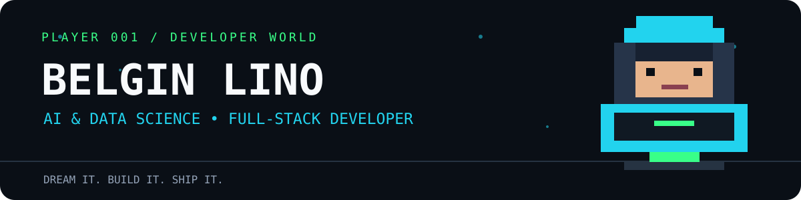
</a>

<!-- Typing banner: role line + the original terminal lines -->
<a href="https://belginlino.in">
  
</a>

<br/><br/>

[](https://belginlino.in)&nbsp;
[](https://github.com/Belginlino)&nbsp;
[](mailto:belginlino485@gmail.com)&nbsp;


<br/>

<!-- Main menu: in-page links to the section anchors below -->
<a href="#player"><code>[ PLAYER ]</code></a>
<a href="#about"><code>[ ABOUT ]</code></a>
<a href="#map"><code>[ MAP ]</code></a>
<a href="#inventory"><code>[ INVENTORY ]</code></a>
<a href="#quests"><code>[ QUESTS ]</code></a>
<a href="#dashboard"><code>[ STATS ]</code></a>
<a href="#trophies"><code>[ TROPHIES ]</code></a>
<a href="#missions"><code>[ MISSIONS ]</code></a>
<a href="#lobby"><code>[ LOBBY ]</code></a>

<br/><br/>

<em>B.Tech student in AI &amp; Data Science who ships complete systems: web apps, computer-vision pipelines, mobile apps and edge hardware.</em>

</div>


<h2 align="center" id="player">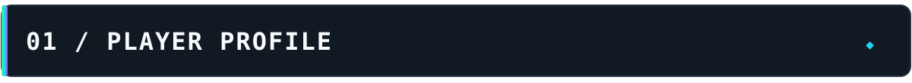</h2>

<div align="center">
  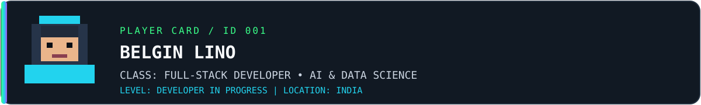
</div>

<br/>

<table align="center" width="100%">
  <tr>
    <th align="left" width="28%">Skill attribute</th>
    <th align="left">Equipped with</th>
  </tr>
  <tr><td><b>Frontend Development</b></td><td>React, Vite, Tailwind CSS, TypeScript, Capacitor, Flutter</td></tr>
  <tr><td><b>Backend Development</b></td><td>FastAPI, Flask, Django, REST APIs, WebSockets, auth workflows</td></tr>
  <tr><td><b>Database Management</b></td><td>MongoDB, MySQL, SQLite, Firebase</td></tr>
  <tr><td><b>AI &amp; Machine Learning</b></td><td>YOLOv8, OpenCV, PyTorch, TensorFlow, LLM agents</td></tr>
  <tr><td><b>Cloud &amp; Deployment</b></td><td>Vercel, Cloudflare, custom DNS, Linux server, Git and GitHub</td></tr>
</table>


<h2 align="center" id="about">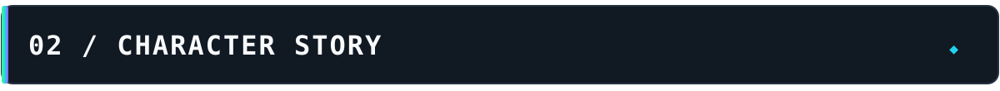</h2>

<pre lang="diff">
+ [IDENTITY]    : Belgin Lino (B.Tech AI &amp; Data Science)
+ [ARCHITECTURE]: React / Vite / FastAPI / Flask / Django
+ [AI_CORE]     : YOLOv8 / OpenCV / Custom Vision Models / LLM Agents
+ [HARDWARE]    : Dual-Rig (Win11 Core + Linux Server) &amp; ESP32 IoT
! [CURRENT_OPS] : Building Autonomous AI &amp; High-Throughput Web Systems
- [BUGS_FOUND]  : 0 (Eliminated in Production)
</pre>

- **Journey:** B.Tech student in AI &amp; Data Science who builds across the whole stack, from ESP32 microcontrollers and computer-vision pipelines to cloud-deployed web apps.
- **Interests:** real-time computer vision, LLM agents, retail and productivity software, IoT lighting, and offline-first learning tools for low-connectivity areas.
- **Goal:** high-impact engineering roles building autonomous AI and high-throughput web systems.
- **Approach:** *"I don't just write code. I engineer complete ecosystems from edge microcontrollers and computer vision pipelines to cloud-deployed web architectures."*

<h2 align="center" id="map">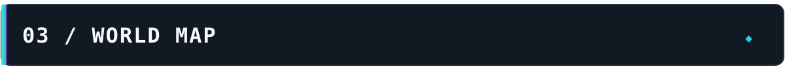</h2>

<div align="center">
  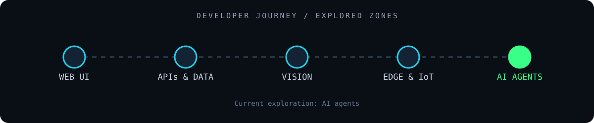
  <br/>
  <sub>Zones are areas of work, not a timeline. AI agents is where I am now.</sub>
</div>


<h2 align="center" id="inventory">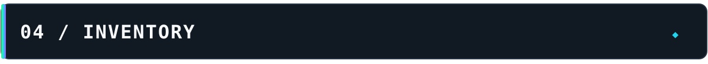</h2>

<table align="center" width="100%">
  <tr>
    <td width="26%"><b>Programming Languages</b></td>
    <td></td>
  </tr>
  <tr>
    <td><b>Frontend</b></td>
    <td><br/><code>Capacitor</code> <code>UI/UX</code> <code>WebSockets</code></td>
  </tr>
  <tr>
    <td><b>Backend</b></td>
    <td><br/><code>REST APIs</code> <code>Auth Workflows</code></td>
  </tr>
  <tr>
    <td><b>Databases</b></td>
    <td></td>
  </tr>
  <tr>
    <td><b>AI &amp; Machine Learning</b></td>
    <td><br/><code>YOLOv8</code> <code>FFmpeg</code> <code>BeautifulSoup</code> <code>LLM Agents</code></td>
  </tr>
  <tr>
    <td><b>Tools &amp; Platforms</b></td>
    <td><br/><code>ESP32</code> <code>Custom DNS</code></td>
  </tr>
</table>


<h2 align="center" id="quests">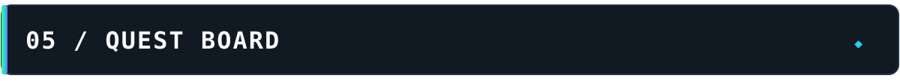</h2>

<h3 align="center">Main quests</h3>

<table width="100%">
  <tr>
    <td width="50%" valign="top">
      <h3 align="center">🚦 <a href="https://github.com/Belginlino/AI-Traffic-Signal">Codewave-5: AI Traffic Control</a></h3>
      <p align="center">
        <b>Real-Time Computer Vision Signal Optimizer</b><br/>
        Analyzes live CCTV lane feeds using YOLOv8 to compute vehicle density and dynamically switch traffic signals via low-latency WebSockets.
      </p>
      <p align="center">
        
        
        
        
      </p>
    </td>
    <td width="50%" valign="top">
      <h3 align="center">🏬 Enterprise Retail ERP Engine</h3>
      <p align="center">
        <b>High-Throughput Inventory &amp; POS System</b><br/>
        Engineered for live retail operations managing 4,000+ SKUs with instant search indexing, automated billing, and local fault-tolerant storage.
      </p>
      <p align="center">
        
        
        
        
        
      </p>
    </td>
  </tr>
  <tr>
    <td width="50%" valign="top">
      <h3 align="center">🛰️ <a href="https://github.com/Belginlino/Satquery-AI">SatQuery AI &amp; Smart Advisor</a></h3>
      <p align="center">
        <b>Geospatial Vision &amp; Automated Decision Systems</b><br/>
        Combines satellite imagery analysis concepts with intelligent web scraping and structured JSON evaluation dashboards for automated insights.
      </p>
      <p align="center">
        
        
        
      </p>
    </td>
    <td width="50%" valign="top">
      <h3 align="center">📱 Gamified Routine &amp; E-Com Suite</h3>
      <p align="center">
        <b>Cross-Platform Mobile &amp; Web Applications</b><br/>
        A streak-driven Capacitor mobile productivity app with custom audio triggers (<a href="https://github.com/Belginlino/myself_productivityapp">repo</a>) and a full-scale Django E-Commerce platform.
      </p>
      <p align="center">
        
        
        
      </p>
    </td>
  </tr>
</table>

<h3 align="center">Side quests</h3>

<table width="100%">
  <tr>
    <td width="50%" valign="top">
      <h4 align="center">📋 <a href="https://github.com/Belginlino/ProjectFlow">ProjectFlow</a></h4>
      <p align="center">
        Academic project intelligence platform that wraps project execution in a verifiable evidence layer, from requirement to task to evidence to mentor review.<br/>
        
      </p>
    </td>
    <td width="50%" valign="top">
      <h4 align="center">💪 <a href="https://github.com/Belginlino/Fit-Tracker">FitTrack</a></h4>
      <p align="center">
        Personal fitness journal and visual transformation tracker: log workouts and body data, add progress photos, compare change over time.<br/>
        
        
        
      </p>
    </td>
  </tr>
  <tr>
    <td width="50%" valign="top">
      <h4 align="center">🚌 <a href="https://github.com/Belginlino/BusTracker">BusTracker</a></h4>
      <p align="center">
        Real-time public transport tracking platform for small cities and tier-2 towns.<br/>
        
        
        
      </p>
    </td>
    <td width="50%" valign="top">
      <h4 align="center">🧍 <a href="https://github.com/Belginlino/Mimo-Game">Mimo</a></h4>
      <p align="center">
        Browser app with a locally rendered default human avatar and an optional face-to-3D flow for provider-backed photo generation.<br/>
        
        
      </p>
    </td>
  </tr>
  <tr>
    <td width="50%" valign="top">
      <h4 align="center">🎬 <a href="https://github.com/Belginlino/moviehub">Moviehub</a></h4>
      <p align="center">
        Minimalistic, IMDb-inspired movie review platform with search, genre filters, Google or email login, and your own reviews.<br/>
        
        
      </p>
    </td>
    <td width="50%" valign="top">
      <h4 align="center">🛒 <a href="https://github.com/Belginlino/techhub">TechHub</a></h4>
      <p align="center">
        E-commerce web application with category navigation, wishlist, cart and a dark/light mode toggle.<br/>
        
        
        
        
      </p>
    </td>
  </tr>
  <tr>
    <td width="50%" valign="top">
      <h4 align="center">🧾 <a href="https://github.com/Belginlino/billing-software">Vogue Menswear POS</a></h4>
      <p align="center">
        Billing point-of-sale and store management system for a men's clothing store.<br/>
        
        
        
      </p>
    </td>
    <td width="50%"></td>
  </tr>
</table>

<details>
  <summary align="center"><b>🕳️ SIDE DUNGEON: Hardware IoT &amp; Experimental Labs</b></summary>
  <br/>
  <table width="100%">
    <tr>
      <td><b>🔌 Custom WLED &amp; MOSFET Smart Lighting</b></td>
      <td>Engineered 12V RGB lighting controllers powered by ESP8266/ESP32 microcontrollers and IRLZ44N logic-level MOSFET switching circuits.</td>
    </tr>
    <tr>
      <td><b>🎬 Local AI Video Inpainting Pipeline</b></td>
      <td>Automated frame extraction and local computer vision restoration workflows utilizing FFmpeg CLI and Python.</td>
    </tr>
    <tr>
      <td><b>🎮 <a href="https://github.com/Belginlino/STEMgenie">STEMGENIE</a> Offline Learning Concept</b></td>
      <td>AI-powered gamified educational architecture designed to bring interactive STEM learning to low-connectivity rural areas.</td>
    </tr>
  </table>
</details>

<details>
  <summary align="center"><b>📜 QUEST LOG: more repositories</b></summary>
  <br/>
  <table width="100%">
    <tr><th align="left">Repository</th><th align="left">Main language</th></tr>
    <tr><td><a href="https://github.com/Belginlino/portfolio">portfolio</a></td><td>TypeScript</td></tr>
    <tr><td><a href="https://github.com/Belginlino/vintage-cafe">vintage-cafe</a></td><td>TypeScript</td></tr>
    <tr><td><a href="https://github.com/Belginlino/nebula-drive">nebula-drive</a></td><td>HTML</td></tr>
    <tr><td><a href="https://github.com/Belginlino/QrCodeGenerator">QrCodeGenerator</a></td><td>JavaScript</td></tr>
    <tr><td><a href="https://github.com/Belginlino/Resume-Builder">Resume-Builder</a></td><td>JavaScript</td></tr>
    <tr><td><a href="https://github.com/Belginlino/image-to-pdf">image-to-pdf</a></td><td>JavaScript</td></tr>
    <tr><td><a href="https://github.com/Belginlino/Image-enhancer-and-BG-remover">Image-enhancer-and-BG-remover</a></td><td>JavaScript</td></tr>
    <tr><td><a href="https://github.com/Belginlino/cjmhsserp">cjmhsserp</a></td><td>JavaScript</td></tr>
    <tr><td><a href="https://github.com/Belginlino/Burj-Khalifa">Burj-Khalifa</a></td><td>JavaScript</td></tr>
    <tr><td><a href="https://github.com/Belginlino/techzone">techzone</a></td><td>CSS</td></tr>
    <tr><td><a href="https://github.com/Belginlino/Calculator">Calculator</a></td><td>HTML</td></tr>
    <tr><td><a href="https://github.com/Belginlino/Todo-list">Todo-list</a></td><td>CSS</td></tr>
  </table>
</details>


<h2 align="center" id="dashboard">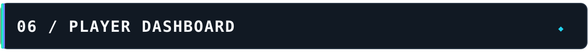</h2>

<div align="center">


<br/><br/>


<br/><br/>

<!-- GitHub-hosted contribution calendar: avoid a broken third-party graph image. -->
<a href="https://github.com/Belginlino?tab=overview#user-activity-overview">
  
</a>

</div>

<!--
  CONTRIBUTION SNAKE (optional, uncomment after setup)
  The workflow in .github/workflows/snake.yml builds the snake on a branch named "output".
  Push this repo, open Actions > "Generate contribution snake" > Run workflow once, then remove the comment markers.

<p align="center">
  <picture>
    <source media="(prefers-color-scheme: dark)" srcset="https://raw.githubusercontent.com/Belginlino/Belginlino/output/github-snake-dark.svg" />
    
  </picture>
</p>
-->


<h2 align="center" id="trophies">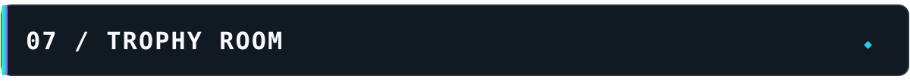</h2>

<!-- Replace the two locked slots with real certifications or internships when you have them. -->
<table width="100%">
  <tr align="center" valign="top">
    <td width="20%">
      <br/>
      <b>Portfolio Online</b><br/>
      <sub><a href="https://belginlino.in">belginlino.in</a> is live</sub>
    </td>
    <td width="20%">
      <br/>
      <b>Retail ERP Live</b><br/>
      <sub>Built for live retail operations at 4,000+ SKUs</sub>
    </td>
    <td width="20%">
      <br/>
      <b>Cross-Platform Builder</b><br/>
      <sub>Web apps, a Capacitor mobile app and ESP32 hardware</sub>
    </td>
    <td width="20%">
      <br/>
      <b>Certification</b><br/>
      <sub>Slot locked</sub>
    </td>
    <td width="20%">
      <br/>
      <b>Internship</b><br/>
      <sub>Slot locked</sub>
    </td>
  </tr>
</table>


<h2 align="center" id="missions">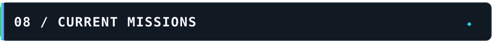</h2>

<table width="100%">
  <tr><th align="left" width="38%">Mission</th><th align="left">Focus</th></tr>
  <tr><td><b>Autonomous AI</b></td><td>LLM agents that plan and act on their own</td></tr>
  <tr><td><b>Real-time vision</b></td><td>YOLOv8 and OpenCV pipelines running on live video feeds</td></tr>
  <tr><td><b>High-throughput web</b></td><td>React and FastAPI services built to scale</td></tr>
  <tr><td><b>Core computer science</b></td><td>Operating Systems and Java, through my B.Tech coursework</td></tr>
</table>


<h2 align="center" id="lobby">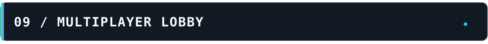</h2>

```bash
$ ssh belgin@developer-world
> connected.

belgin@lobby:~$ cat contact.txt
github     https://github.com/Belginlino
portfolio  https://belginlino.in
email      belginlino485@gmail.com

belgin@lobby:~$ status
Available for high-impact engineering roles
```

<div align="center">

[](https://belginlino.in)&nbsp;
[](https://github.com/Belginlino)&nbsp;
[](mailto:belginlino485@gmail.com)

</div>

<!-- LinkedIn: no LinkedIn URL exists in the original README, so none was added. Add a JOIN-LINKEDIN badge here once you have the link. -->


<h2 align="center" id="secret">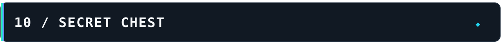</h2>

<details>
  <summary align="center"><b>🗝️ Open the chest</b></summary>
  <br/>
  <p align="center">
    <code>↑ ↑ ↓ ↓ ← → ← → B A</code><br/><br/>
    You read the whole README, so you get the real secret: every project above started as a small idea and a blank repo.<br/>
    If you have a quest worth building, <a href="mailto:belginlino485@gmail.com">send me a message</a> or take a look at the <a href="https://belginlino.in">portfolio</a>.
  </p>
</details>

<br/>

<div align="center">
  <code>⚡ ENGINEERED BY BELGIN LINO • DREAM IT. BUILD IT. SHIP IT. ⚡</code>
</div>